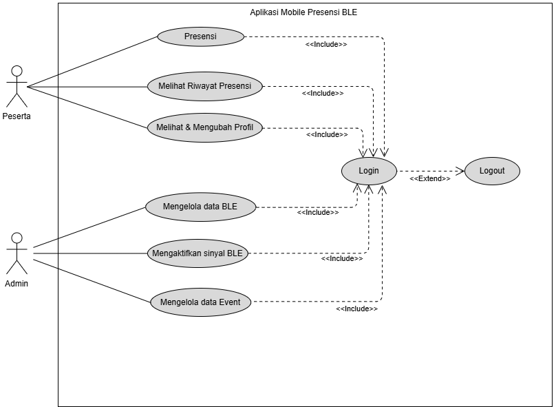
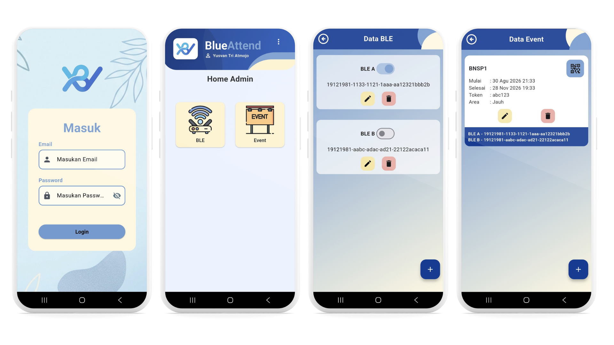
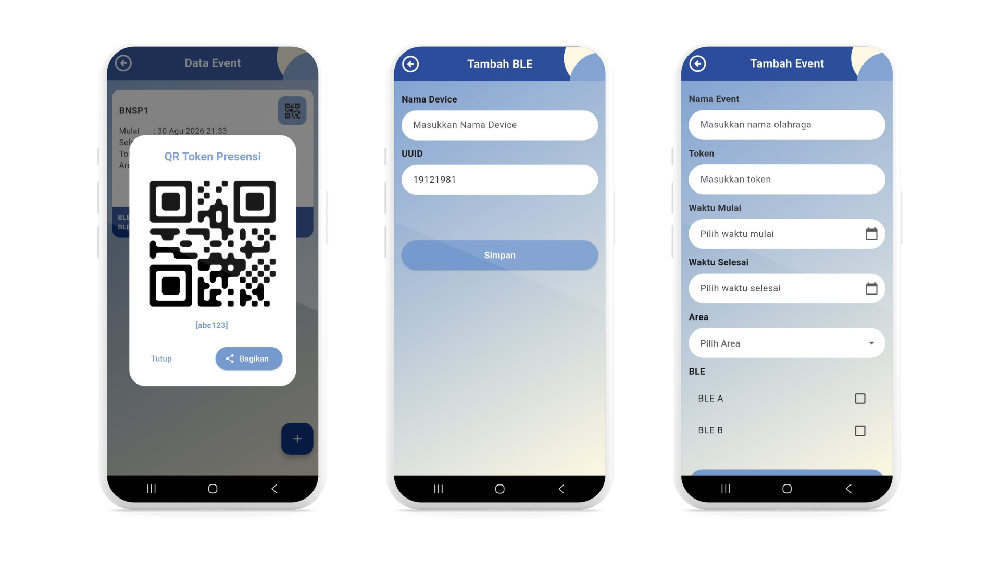
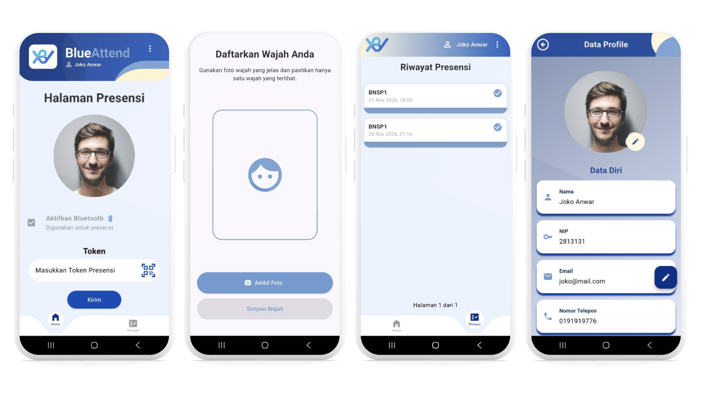

  

# 📱 BlueAttend - Mobile App

> **BlueAttend Mobile** Aplikasi berbasis Flutter yang memungkinkan pengguna melakukan presensi berdasarkan kedekatan lokasi melalui Bluetooth Low Energy (BLE) dan verifikasi wajah (face recognition). Token presensi dapat dimasukkan secara manual melalui teks maupun diperoleh dengan memindai QR Code. Admin dapat mengatur perangkat Bluetooth yang digunakan sebagai titik presensi serta mengelola event presensi. Aplikasi ini menyediakan antarmuka yang intuitif untuk melakukan presensi dan mengelola sistem presensi melalui integrasi dengan BlueAttend RESTful API Backend.

---

## 🛠️ Tech Stack & Arsitektur

- **Framework:** Flutter (Dart)
- **Architecture:** Clean Architecture (Presentation, Domain, Data)
- **State Management:** BLoC
- **Repository Pattern:** Repository Pattern
- **Networking:** RESTful API (HTTP)
- **Target Platform:** Android
- **Bluetooth:** Bluetooth Low Energy (BLE)
- **Face Detection:** Google ML Kit
- **QR Code:** Pretty QR Code
- **QR Scanner:** Mobile Scanner

---

## ✨ Fitur 

Berikut adalah fitur yang ada pada aplikasi BlueAttend melalui use case diagram:

  

## 📱 Hasil Tampilan Aplikasi BlueAttend

Berikut adalah beberapa tampilan hasil dari aplikasi BlueAttend:

  

  

  

---

## 🔗 Backend Repository

Backend source code is available at:

- [BlueAttend Backend](https://github.com/YusvanTriAtmojo/BlueAttend_BE)
